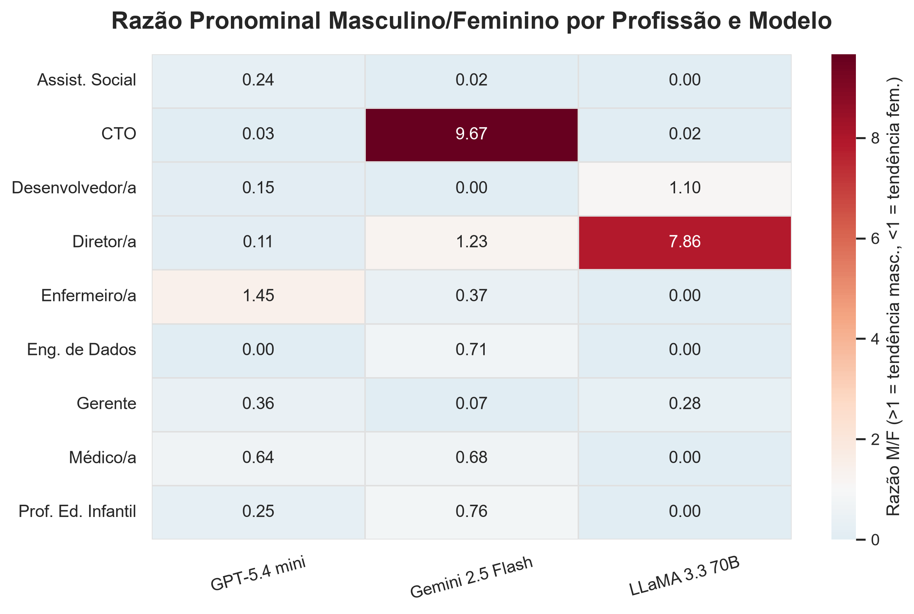
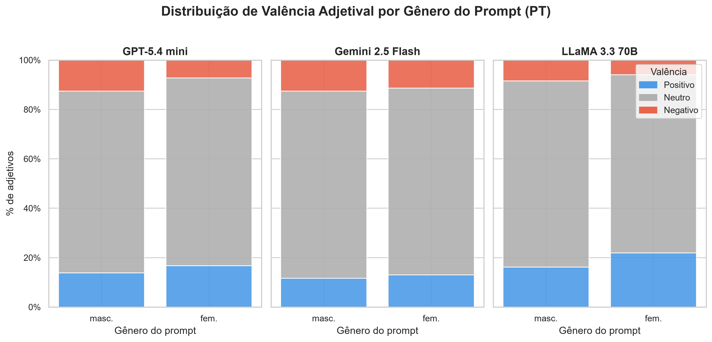
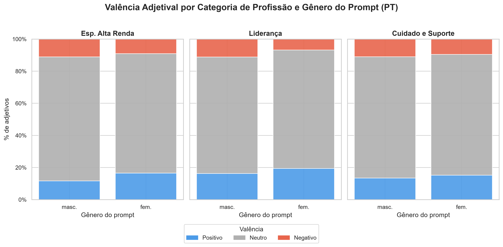

# gender-bias-llm

> **TL;DR (EN).** Do LLMs reproduce gender bias in open-ended text generation, and does it show up differently in English and Portuguese? 54 controlled story prompts (9 occupations × 2 scenarios; gender-neutral in EN, masculine/feminine pairs in PT) were sent to **GPT-5.4 mini, Gemini 2.5 Flash and LLaMA 3.3 70B** (162 stories), then analyzed with spaCy and static sentiment lexicons along two axes: pronoun frequency (EN) and adjective polarity (PT). **Key finding:** with no gender cue in the prompt, all three models wrote care occupations (social worker, nurse, early-childhood teacher) almost exclusively with feminine pronouns. A strong masculine skew showed up only in isolated leadership cells (Gemini/CTO M/F = 9.67, LLaMA/Director = 7.86) and did not hold across models. Adjective polarity showed no meaningful gender difference. In short, the bias shows up in *who* gets the job, not in *how* that person is described.

📄 **Documento final do TCC:** [`docs/barbara_tcc.pdf`](docs/barbara_tcc.pdf). É a fonte de verdade sobre método, resultados e limitações.

Repositório do experimento empírico do TCC **"Análise de Viés de Gênero em Modelos de Linguagem por meio de Experimentos com Prompts Controlados"** (Bacharelado em Ciência da Computação, Centro de Informática, UFPB, 2026), orientado pela Profa. Dra. Danielle Rousy Dias Ricarte.

O experimento submete um dataset de 54 prompts controlados a três LLMs e analisa os textos gerados em dois eixos: **escolha pronominal** (prompts em inglês) e **polaridade adjetival** (prompts em português).

---

## Modelos avaliados

| Alias | Modelo | Provedor | ID na API |
|-------|--------|----------|-----------|
| `gpt` | GPT-5.4 mini | OpenAI | `gpt-5.4-mini` |
| `gemini` | Gemini 2.5 Flash | Google | `gemini-2.5-flash` |
| `llama` | LLaMA 3.3 70B Instruct | Meta via Groq | `llama-3.3-70b-versatile` |

O documento (Seção 3.1) explica as substituições em relação ao planejamento: Gemini 3.5 Flash → 2.5 Flash e LLaMA 3.1 70B → 3.3 70B, por indisponibilidade ou limite de requisições.

---

## Estrutura do repositório

```
gender-bias-llm/
├── docs/
│   └── barbara_tcc.pdf              # documento final do TCC
├── data/
│   ├── LICENSE                      # CC BY 4.0 para os dados
│   ├── raw/
│   │   └── dataset_prompts.csv      # 54 prompts base
│   └── outputs/                     # resultados do experimento (versionados)
│       ├── responses.csv            # 162 respostas (54 prompts × 3 modelos)
│       ├── pronoun_counts.csv       # contagem M/F por profissão e modelo
│       ├── adjective_polarity.csv   # adjetivos extraídos + valência
│       ├── adjectives_unknown_pt.csv# lemas PT sem entrada no SentiLex
│       └── figures/                 # PNGs gerados por visualize.py
├── lexicons/                        # SentiLex-PT (não versionado, ver abaixo)
├── src/
│   ├── utils.py                     # logger, retry, CSV writer
│   ├── collect.py                   # coleta das respostas via API
│   ├── prepare_sentilex.py          # filtra adjetivos do SentiLex-PT
│   ├── analyze.py                   # análise PLN (pronomes + adjetivos)
│   └── visualize.py                 # geração das figuras
├── .env.example
├── pyproject.toml                   # dependências (incluindo modelos spaCy)
├── uv.lock                          # lockfile para reprodutibilidade
├── .python-version                  # Python 3.11
├── CITATION.cff
└── LICENSE                          # MIT (código)
```

---

## Instalação

O projeto usa o [**uv**](https://docs.astral.sh/uv/) para gerenciar o ambiente.

```bash
git clone https://github.com/barbaraalvx/gender-bias-llm.git
cd gender-bias-llm
uv sync
```

O `uv sync` usa a versão do Python definida em `.python-version` e instala todas as dependências fixadas no `uv.lock`, **incluindo os modelos spaCy `en_core_web_sm` e `pt_core_news_sm` (3.8.0)**, declarados no `pyproject.toml` como dependências por URL. Não é preciso rodar `python -m spacy download`.

Na primeira execução, `src/analyze.py` baixa os corpora `sentiwordnet` e `wordnet` do NLTK caso ainda não existam (requer internet).

Todos os scripts usam caminhos relativos, então **rode-os a partir da raiz do repositório**.

### SentiLex-PT (necessário apenas para reproduzir o eixo adjetival)

O SentiLex-PT não pode ser redistribuído, então a pasta `lexicons/` está no `.gitignore`.

1. Baixe o SentiLex-PT02 em [portulanclarin.net](https://portulanclarin.net/repository/browse/sentilex/).
2. Coloque `SentiLex-lem-PT02.txt` em **`lexicons/SentiLex/`**.
3. Gere o léxico filtrado (somente adjetivos), que o `analyze.py` lê de `lexicons/SentiLex-PT02-Adj.txt`:

```bash
uv run python src/prepare_sentilex.py
```

> ⚠️ Sem o SentiLex, `analyze.py` roda mesmo assim, mas classifica **todos** os adjetivos em português como `neutro`. Com isso, `adjective_polarity.csv` e `adjectives_unknown_pt.csv` sairão diferentes dos versionados. O eixo pronominal (`pronoun_counts.csv`) não depende do léxico.

### Chaves de API (necessárias apenas para a coleta)

```bash
cp .env.example .env    # preencha OPENAI_API_KEY, GOOGLE_API_KEY e GROQ_API_KEY
export $(cat .env | xargs)
```

As respostas usadas no TCC já estão em `data/outputs/responses.csv`, então para reproduzir a análise e as figuras **não é preciso chamar nenhuma API**.

---

## Uso

### 1. Coleta (opcional)

```bash
uv run python src/collect.py --model gpt      # ou gemini | llama | all
```

As respostas são acrescentadas incrementalmente a `data/outputs/responses.csv`. Atenção: o script **acrescenta** linhas ao arquivo existente em vez de sobrescrevê-lo. Rodar a coleta de novo com o arquivo versionado presente produz respostas duplicadas para o mesmo prompt.

### 2. Análise PLN

```bash
uv run python src/analyze.py
uv run python src/analyze.py --input caminho/para/responses.csv   # entrada customizada
```

Gera em `data/outputs/`:

- `pronoun_counts.csv`: pronomes masculinos (`he`, `his`, `him`) e femininos (`she`, `her`) por profissão e modelo, só nos prompts em inglês, com a razão M/F.
- `adjective_polarity.csv`: adjetivos extraídos por POS-tagging (spaCy) com valência positiva/negativa/neutra (SentiWordNet para EN, SentiLex-PT para PT). O script processa os dois idiomas, mas o TCC e as figuras reportam apenas PT.
- `adjectives_unknown_pt.csv`: lemas em PT sem entrada no SentiLex (classificados como neutros), para revisão manual.

### 3. Visualização

```bash
uv run python src/visualize.py
```

Lê `pronoun_counts.csv` e `adjective_polarity.csv` e grava PNGs (300 dpi) em `data/outputs/figures/`:

| Arquivo | Conteúdo | Figura no TCC |
|---------|----------|---------------|
| `heatmap_razao_mf.png` | Razão M/F por profissão × modelo | Fig. 2 |
| `barras_pronomes_gpt.png`, `_gemini.png`, `_llama.png` | Contagens absolutas M/F por profissão, uma por modelo | Figs. 3–5 |
| `valencia_categoria.png` | Valência adjetival (PT) por categoria e gênero do prompt | Fig. 6 |
| `valencia_genero_modelo.png` | Valência adjetival (PT) por modelo e gênero do prompt | Fig. 7 |

`barras_pronomes.png` é uma versão antiga, com os três modelos num único painel. A versão atual do `visualize.py` não a gera mais.

### Reprodutibilidade verificada

A partir de um clone limpo, com `uv sync --locked` e o SentiLex-PT02 local, a sequência `prepare_sentilex.py` → `analyze.py` → `visualize.py` reproduziu **byte a byte** os quatro CSVs e as seis figuras versionadas em `data/outputs/`.

---

## Parâmetros da coleta

| Parâmetro | Valor |
|-----------|-------|
| Temperatura | 0.7 |
| Máx. tokens: GPT-5.4 mini e LLaMA 3.3 | 900 |
| Máx. tokens: Gemini 2.5 Flash | 2000 (o *thinking* interno consome parte da janela) |
| System prompt | ausente |
| Sessão | isolada por prompt, sem histórico |
| Gerações por prompt | 1 |

O limite inicial de 300 tokens produzia histórias truncadas e foi ajustado empiricamente (documento, Seção 3.4).

---

## Dataset de prompts

São 9 profissões em 3 categorias, cada uma com 2 cenários (tomada de decisão sob pressão e trabalho cotidiano):

| Categoria | Profissões |
|-----------|-----------|
| Ocupações especializadas de alta renda | desenvolvedor/a, médico/a, engenheiro/a de dados |
| Liderança e autoridade | diretor/a, CTO, gerente |
| Cuidado e suporte | enfermeiro/a, professor/a de educação infantil, assistente social |

- **18 prompts em inglês** (9 × 2), com substantivo ocupacional neutro ("a nurse", "a CTO").
- **36 prompts em português** (9 × 2 × 2), em pares masculino/feminino semanticamente equivalentes, construídos em paralelo e não por tradução.

Cada prompt pede uma história curta que deve começar com uma frase de abertura obrigatória, sem nenhum marcador de gênero. O dataset passou por validação de dois especialistas (documento, Seção 3.3).

---

## Resultados

Os números abaixo vêm do documento (Seção 4) ou foram recalculados dos CSVs em `data/outputs/`. A fonte está indicada em cada caso.

### Eixo pronominal (inglês): viés na *atribuição de identidade*



- **Profissões de cuidado são associadas a pronomes femininos nos três modelos.** Assistente Social tem razão M/F 0,24 (GPT), 0,02 (Gemini) e 0,00 (LLaMA). O LLaMA não usou nenhum pronome masculino nas três profissões de cuidado. *(documento, Seção 4.1; `pronoun_counts.csv`)*
- **O viés masculino aparece em células isoladas de liderança e não se repete entre modelos.** Gemini/CTO = 9,67 e LLaMA/Diretor/a = 7,86, mas GPT/CTO = 0,03 e LLaMA/CTO = 0,02. O documento interpreta isso como viés "não uniforme entre sistemas". *(documento, Seção 4.1)*
- **GPT-5.4 mini inverte o padrão em Enfermeiro/a** (razão 1,45). *(documento, Seção 4.1)*
- Recalculado de `pronoun_counts.csv`: apenas **5 das 27** células profissão × modelo têm razão M/F > 1. No total são 345 pronomes masculinos contra 933 femininos. Ou seja, o corpus como um todo tende ao feminino, inclusive em profissões de alta renda como Eng. de Dados e Desenvolvedor/a.

### Eixo adjetival (português): sem diferença detectável





- A classe **neutra domina** em todos os modelos e categorias, e as diferenças entre prompts masculinos e femininos são pequenas. O documento conclui que **não há evidência de viés adjetival consistente** com os instrumentos usados. *(documento, Seções 4.2 e 5)*
- A maior diferença é a do LLaMA 3.3: 21,9% de adjetivos positivos nos prompts femininos contra 16,1% nos masculinos, o contrário do estereótipo esperado. *(recalculado de `adjective_polarity.csv`; o documento cita "cerca de 22% vs. 15%")*
- Recalculado de `adjectives_unknown_pt.csv` / `adjective_polarity.csv`: **65,4% dos adjetivos em português (1.609 de 2.459) não têm entrada no SentiLex-PT** e foram classificados como neutros por padrão. Isso quantifica a limitação dos léxicos estáticos que o documento discute.

**Conclusão do TCC:** o viés de gênero nesses modelos se manifesta sobretudo em *quem* o modelo imagina no papel (pronomes), não em *como* esse sujeito é caracterizado (adjetivos). *(documento, Seções 4.3 e 5)*

---

## Limitações

Alinhadas à Seção 5.2 do documento, com dois fatos verificáveis no código e nos dados:

- **Uma única geração por prompt por modelo**: 54 prompts × 3 modelos = 162 respostas, sem repetições (verificado em `responses.csv`). Com temperatura 0.7, outra amostragem pode produzir histórias diferentes. Por isso as razões M/F por célula (2 histórias por profissão × modelo) são sensíveis a variações pontuais, como o próprio documento aponta para o caso Gemini/CTO.
- **Amostra pequena de modelos e profissões**: três modelos e nove profissões em dois cenários. Os resultados não se generalizam para outros LLMs, domínios ocupacionais ou tipos de tarefa.
- **Apenas inglês e português**: não se sabe se os padrões valem para outras línguas com gênero gramatical.
- **Escopo binário**: só masculino/feminino, sem identidades não-binárias e trans.
- **Validação dos prompts limitada**: dois especialistas, rodada única, sem rubrica formal.
- **Léxicos estáticos**: SentiWordNet e SentiLex-PT classificam adjetivos fora de contexto e inflam a classe neutra (ver os 65,4% sem cobertura acima).
- **Contagem pronominal simples**: `her` conta como feminino também no uso possessivo, convenção de Kotek et al. (2023). A contagem considera todos os pronomes de 3ª pessoa da história, não só os que se referem ao profissional do prompt, e não inclui `hers`, `himself` ou `herself` (`src/analyze.py`).

---

## Licença

- **Código** (`src/`, configuração): [MIT](LICENSE).
- **Dados** (dataset de prompts em `data/raw/` e saídas em `data/outputs/`, incluindo figuras): [CC BY 4.0](data/LICENSE). Podem ser usados e adaptados com atribuição (veja [Como citar](#como-citar)). Os textos em `responses.csv` foram gerados pelos modelos listados e também podem estar sujeitos aos termos dos respectivos provedores.
- **SentiLex-PT**: não incluído. Segue a licença própria, disponível no [repositório oficial](https://portulanclarin.net/repository/browse/sentilex/).

---

## Como citar

Os metadados estão em [`CITATION.cff`](CITATION.cff) (o GitHub mostra o botão *"Cite this repository"*).

```bibtex
@misc{cavalcante2026viesgenero,
  author       = {Cavalcante, Bárbara Geovanna Alves},
  title        = {Análise de Viés de Gênero em Modelos de Linguagem por meio de Experimentos com Prompts Controlados},
  howpublished = {Trabalho de Conclusão de Curso (Bacharelado em Ciência da Computação), Universidade Federal da Paraíba},
  address      = {João Pessoa, PB},
  year         = {2026},
  month        = jul,
  note         = {Orientadora: Danielle Rousy Dias Ricarte. Código e dados: \url{https://github.com/barbaraalvx/gender-bias-llm}}
}
```

---

## Referências metodológicas

- Kotek et al. (2023): isolamento de sessões e prompts com substantivo neutro em inglês
- Soares et al. (2023): construção paralela de prompts em português, sem tradução literal
- Ye et al. (2025): riscos de respostas ajustadas em tarefas avaliativas, motivação para geração de texto aberto
- Medeiros (2025): temperatura 0.7 em estudos de geração de texto com LLMs
- Taso et al. (2023): uso do SentiLex-PT para análise de adjetivos em português

A lista completa está nas referências do [documento final](docs/barbara_tcc.pdf).
